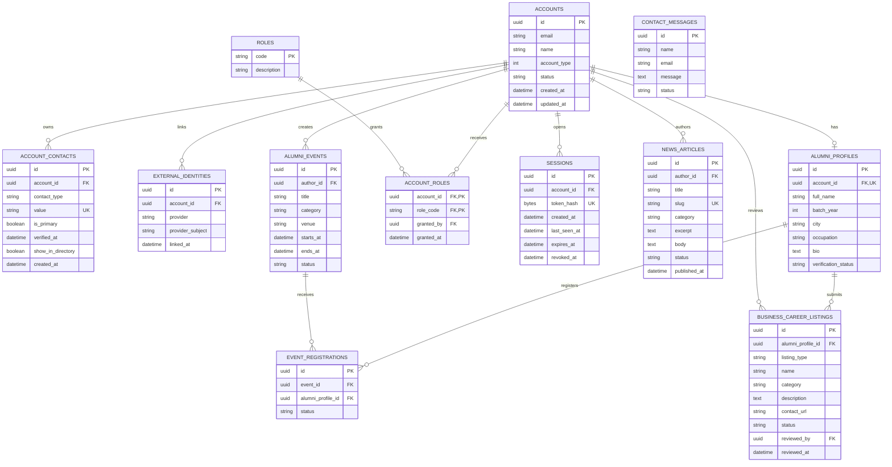

# AlumniHub ERD

The alumni domain is additive at the model level. In this Go API repository,
the versioned migration creates the `accounts` identity table with the LMS
compatibility columns shown below; profile and authorization data are modeled
separately. If this API is deployed into a physical database that already has
an LMS `accounts` table, reconcile its column and ID types with this model
before applying migration `000002`. The existing `email`, `name`, and
`account_type` columns remain for LMS compatibility. `accounts.email` is
nullable in the target model
so phone-only registration and OAuth accounts without a verified email are
supported; it is a legacy mirror, not a second source of truth. Verified email
addresses and phone numbers in
`account_contacts` are the canonical AlumniHub login contacts.

## Account, contacts, and sessions

- `accounts.status` is `active|disabled`. An account is created or activated
  only after an email/phone login contact is verified or an external OAuth
  identity is authenticated. Public visitors are anonymous and do not have an
  account or an assigned role.
- Existing `accounts.email`, `accounts.name`, and `accounts.account_type`
  columns are retained for LMS compatibility. When an email contact exists,
  the legacy email may mirror its primary verified value; phone-only accounts
  have no legacy email. AlumniHub authentication and role checks use
  `account_contacts` and `account_roles`, not those legacy columns.
- Each `account_contacts` row represents one email address or phone number.
  `value` is stored in canonical form (lowercase email or E.164 phone number)
  and is unique across accounts. `verified_at IS NULL` means unverified;
  unverified contacts cannot be used to authenticate. At most one contact per
  account is primary for each contact type.
- `show_in_directory` defaults to false and can only be true for a verified
  phone contact. Email contacts are never exposed in the alumni directory.
  The API still applies the owner's visibility setting when returning phone
  numbers.
- `external_identities` supports Google and Facebook login. The provider
  subject is unique within a provider; provider tokens are not stored as
  session credentials. The authenticated provider subject is a login
  credential. An email or phone number is considered verified only when the
  provider's verified claim is explicitly validated; otherwise it is not
  stored as a verified login contact.
- A `sessions` row stores only a cryptographic hash of a high-entropy opaque
  session token, never the raw token. The browser receives the token only in a
  `Secure`, `HttpOnly`, same-site cookie. Expired or revoked sessions are
  invalid. Session rows support individual logout and account-wide revocation.

## Alumni roles and status

`roles.code` is restricted to `member|officer|admin`. `account_roles` allows
multiple roles, so an officer or administrator can also have a member profile.
The member's verification state is represented once, by
`alumni_profiles.verification_status`, rather than duplicated as a second
member role:

- `non_verified` is the default for a newly created alumni profile.
- `verified` is set only after at least five valid peer attestations and final
  admin approval.

The effective access levels are resolved server-side:

| Effective access | Model rule |
| --- | --- |
| Public | Anonymous request; no account role. |
| Non-verified member | Active account, `member` role, and `non_verified` profile. |
| Verified member | Active account, `member` role, and `verified` profile. |
| Pengurus (officer) | Active account with the `officer` role; document actions still require the relevant permission. |
| Admin | Active account with the `admin` role. |

The role assignment is not a substitute for object-level authorization.
Profile ownership, document permissions, and the admin-only final verification
decision are checked by the backend for each action. `granted_by` is null only
for initial/system assignment; privileged role grants must record the
administering account.

## Content and workflow status

Allowed `status` values: accounts `active|disabled`; alumni profiles
`non_verified|verified`; news and events `draft|pending_review|published|rejected|archived`;
listings `pending|approved|rejected`; registrations
`registered|cancelled|attended`; contact messages `new|read|closed`.
Publication and verification transitions are performed by the backend and
must be audited. `pending_review` and rejection decisions for verification
requests belong to the verification workflow, not a duplicate profile status.
