# AlumniHub ERD

The alumni domain is additive at the model level. In this Go API repository,
the versioned migration creates the `accounts` identity table with the LMS
compatibility columns shown below; profile and authorization data are modeled
separately. If this API is deployed into a physical database that already has
an LMS `accounts` table, reconcile its column and ID types with this model
before applying migration `000002`. The existing `email`, `name`, and
`account_type` columns remain for LMS compatibility. `accounts.email` is
nullable in the target model
so phone-only registration and OAuth accounts without a verified email are
supported by the schema; phone OTP is not enabled in the current release. It
is a legacy mirror, not a second source of truth. Verified email addresses and
phone numbers in
`account_contacts` are the canonical AlumniHub login contacts.

```mermaid
erDiagram
    ACCOUNTS ||--o{ ACCOUNT_CONTACTS : owns
    ACCOUNTS ||--o{ EXTERNAL_IDENTITIES : links
    ACCOUNTS ||--o| ALUMNI_PROFILES : has
    ACCOUNTS ||--o| ALUMNI_PROFILE_PHOTOS : has
    ACCOUNTS ||--o{ ACCOUNT_ROLES : receives
    ROLES ||--o{ ACCOUNT_ROLES : grants
    ACCOUNTS ||--o{ SESSIONS : opens
    ACCOUNTS ||--o| PASSWORD_CREDENTIALS : authenticates
    ACCOUNTS ||--o{ NEWS_ARTICLES : authors
    ACCOUNTS ||--o{ ALUMNI_EVENTS : creates
    ALUMNI_PROFILES ||--o{ EVENT_REGISTRATIONS : registers
    ALUMNI_PROFILES ||--o| VERIFICATION_REQUESTS : requests
    ALUMNI_PROFILES ||--o{ ALUMNI_ATTESTATIONS : receives
    ACCOUNTS ||--o{ ALUMNI_ATTESTATIONS : gives
    ALUMNI_EVENTS ||--o{ EVENT_REGISTRATIONS : receives
    ALUMNI_PROFILES ||--o{ BUSINESS_CAREER_LISTINGS : submits
    ACCOUNTS ||--o{ BUSINESS_CAREER_LISTINGS : reviews

    ACCOUNTS {
        uuid id PK
        string email
        string name
        int account_type
        string status
        datetime created_at
        datetime updated_at
    }
    ACCOUNT_CONTACTS {
        uuid id PK
        uuid account_id FK
        string contact_type
        string value UK
        boolean is_primary
        datetime verified_at
        boolean show_in_directory
        datetime created_at
    }
    EXTERNAL_IDENTITIES {
        uuid id PK
        uuid account_id FK
        string provider
        string provider_subject
        datetime linked_at
    }
    ALUMNI_PROFILES {
        uuid id PK
        uuid account_id FK,UK
        string full_name
        int batch_year
        string city
        string country_code
        string city_code
        string occupation
        text bio
        string verification_status
    }
    VERIFICATION_REQUESTS {
        uuid profile_id PK,FK
        string status
        string decision_kind
        datetime requested_at
        uuid decided_by FK
        datetime decided_at
        string decision_note
    }
    ALUMNI_ATTESTATIONS {
        uuid id PK
        uuid profile_id FK
        uuid attester_id FK
        datetime created_at
    }
    ALUMNI_PROFILE_PHOTOS {
        uuid account_id PK,FK
        string mime_type
        string file_name
        bytes image_data
        datetime updated_at
    }
    ROLES {
        string code PK
        string description
    }
    ACCOUNT_ROLES {
        uuid account_id FK,PK
        string role_code FK,PK
        uuid granted_by FK
        datetime granted_at
    }
    SESSIONS {
        uuid id PK
        uuid account_id FK
        bytes token_hash UK
        datetime created_at
        datetime last_seen_at
        datetime expires_at
        datetime revoked_at
    }
    PASSWORD_CREDENTIALS {
        string username PK
        uuid account_id FK,UK
        string password_hash
        boolean is_enabled
    }
    NEWS_ARTICLES {
        uuid id PK
        uuid author_id FK
        string title
        string slug UK
        string category
        text excerpt
        text body
        string status
        datetime published_at
    }
    ALUMNI_EVENTS {
        uuid id PK
        uuid author_id FK
        string title
        string category
        string venue
        datetime starts_at
        datetime ends_at
        string status
    }
    EVENT_REGISTRATIONS {
        uuid id PK
        uuid event_id FK
        uuid alumni_profile_id FK
        string status
    }
    BUSINESS_CAREER_LISTINGS {
        uuid id PK
        uuid alumni_profile_id FK
        string listing_type
        string name
        string category
        text description
        string contact_url
        string status
        uuid reviewed_by FK
        datetime reviewed_at
    }
    CONTACT_MESSAGES {
        uuid id PK
        string name
        string email
        text message
        string status
    }
```

## Account, contacts, and sessions

- `accounts.status` is `active|disabled`. Current self-registration creates an
  account after email OTP verification; OAuth can also create an onboarding
  account. Phone contacts are modeled but phone OTP is not enabled. Public
  visitors are anonymous and do not have an account or an assigned role.
- Existing `accounts.email`, `accounts.name`, and `accounts.account_type`
  columns are retained for LMS compatibility. When an email contact exists,
  the legacy email may mirror its primary verified value; phone-only accounts
  have no legacy email. AlumniHub authentication and role checks use
  `account_contacts` and `account_roles`, not those legacy columns.
- Each `account_contacts` row represents one email address or phone number.
  `value` is stored in canonical form (lowercase email or E.164 phone number)
  and is unique across accounts. Current user registration creates email
  contacts only. `verified_at IS NULL` means unverified;
  unverified contacts cannot be used to authenticate. At most one contact per
  account is primary for each contact type.
- `show_in_directory` defaults to false and can only be true for a verified
  phone contact. Email contacts are never exposed in the alumni directory.
  The API still applies the owner's visibility setting when returning phone
  numbers.
- `external_identities` supports Google and Facebook login. The provider
  subject is unique within a provider; provider tokens are not stored as
  session credentials. The authenticated provider subject is a login
  credential. A provider email is stored as a verified contact only when the
  provider's verified claim is explicitly validated; otherwise it is an
  unverified contact until email OTP confirms it. OAuth providers do not
  provide a phone contact through the configured login scopes.
- `email_otp_challenges` stores only a keyed hash of the short-lived OTP and
  tracks its purpose, expiry, attempt count, and consumption. The HMAC key is
  the private Resend API credential. `registration_tokens` stores only a hash
  of the one-use profile-registration token.
- `alumni_profile_photos` references one sanitized JPEG/PNG per member, with a
  2 MiB upload limit. With `FILE_STORAGE_DIR` set the image is a file on disk
  and only a server-generated `file_name` is stored; otherwise (and for rows
  written before file storage) the bytes are in `image_data`. A CHECK
  constraint allows exactly one of the two. The image is not exposed in the
  directory projection.
- A `sessions` row stores only a cryptographic hash of a high-entropy opaque
  session token, never the raw token. The browser receives the token only in a
  `Secure`, `HttpOnly`, same-site cookie. Expired or revoked sessions are
  invalid. Session rows support individual logout and account-wide revocation.
  Optional staging username/password accounts use `password_credentials`; the
  table stores a bcrypt password hash, never the plaintext password. The
  configured four staging roles are assigned server-side and are not supplied by
  the login request.

## Alumni roles and status

`roles.code` is restricted to `member|officer|admin`. `account_roles` allows
multiple roles, so an officer or administrator can also have a member profile.
The member's verification state is represented once, by
`alumni_profiles.verification_status`, rather than duplicated as a second
member role:

- `non_verified` is the default for a newly created alumni profile.
- `verified` is set only after at least five valid peer attestations and final
  admin approval.

The effective access levels are resolved server-side:

| Effective access | Model rule |
| --- | --- |
| Public | Anonymous request; no account role. |
| Onboarding | Authenticated account with `member` role but no alumni profile yet; only public-content capability until required profile/photo submission. |
| Non-verified member | Active account, `member` role, and `non_verified` profile. |
| Verified member | Active account, `member` role, and `verified` profile. |
| Pengurus (officer) | Active account with the `officer` role; document actions still require the relevant permission. |
| Admin | Active account with the `admin` role. |

The role assignment is not a substitute for object-level authorization.
Profile ownership, document permissions, and the admin-only final verification
decision are checked by the backend for each action. `granted_by` is null only
for initial/system assignment; privileged role grants must record the
administering account.

## Verification workflow

- `verification_requests` has one row per profile. `status` is
  `pending|approved|rejected`; `decision_kind` is `peer` or `bootstrap`.
  A rejected request can be reopened by the member (back to `pending`).
- `alumni_attestations` is unique on `(profile_id, attester_id)`. The API only
  accepts an attestation from a member of the *same batch* (verified or not)
  who has an alumni profile and is not the candidate, on a `pending` request.
  At decision time only attestations whose attester is still active and
  same-batch count; the Admin sees whether each attester is verified.
- An Admin may approve only with at least five valid attestations. The
  one-time first-member exception (`decision_kind = 'bootstrap'`) lets a
  Pengurus or Admin confirm a pending member while no alumnus is verified; it
  is serialized with a row lock so it can be used once.
- Approval sets `alumni_profiles.verification_status = 'verified'`; every
  step writes an `audit_events` row (`verification.request|attest|approve|
  reject|bootstrap_approve`).

## Content and workflow status

Allowed `status` values: accounts `active|disabled`; alumni profiles
`non_verified|verified`; news and events `draft|pending_review|published|rejected|archived`;
listings `pending|approved|rejected`; registrations
`registered|cancelled|attended`; contact messages `new|read|closed`.
Publication and verification transitions are performed by the backend and
must be audited. `pending_review` and rejection decisions for verification
requests belong to the verification workflow, not a duplicate profile status.
